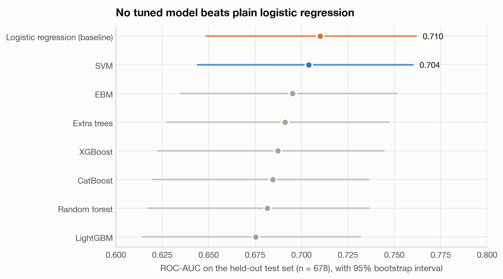
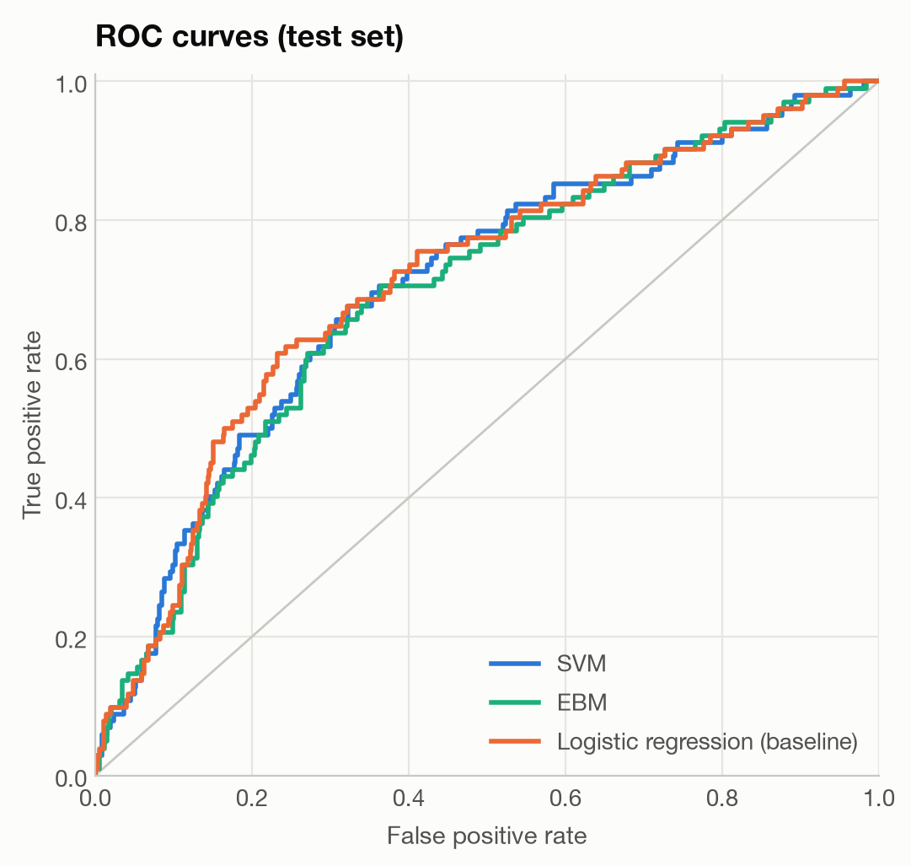
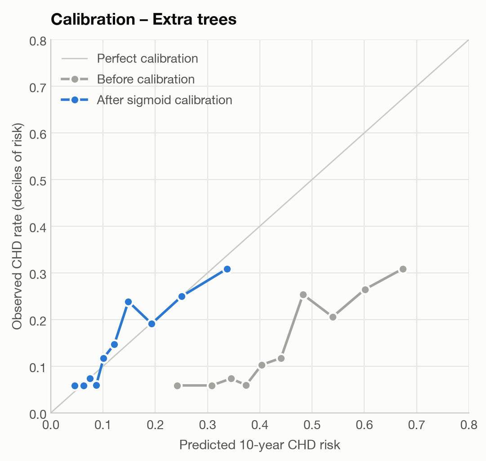
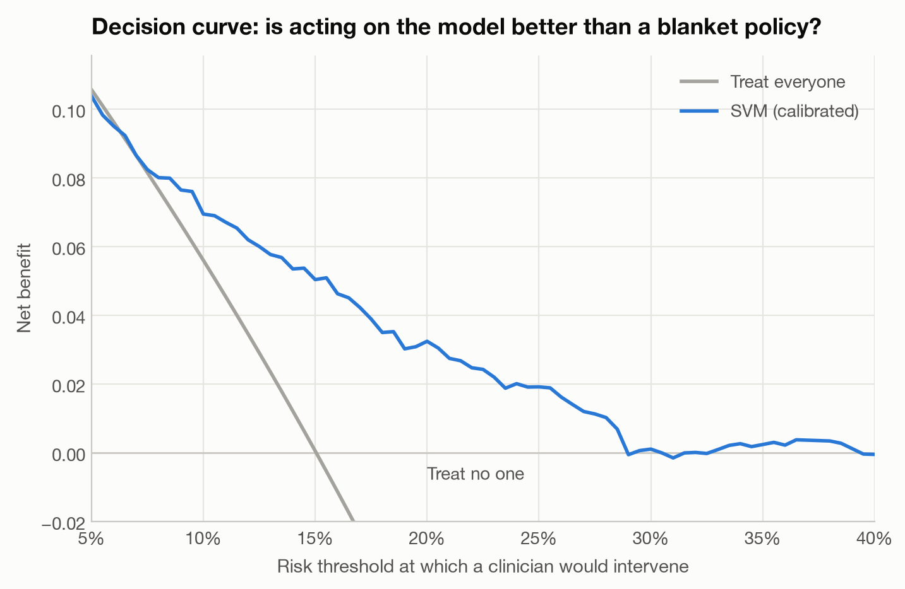
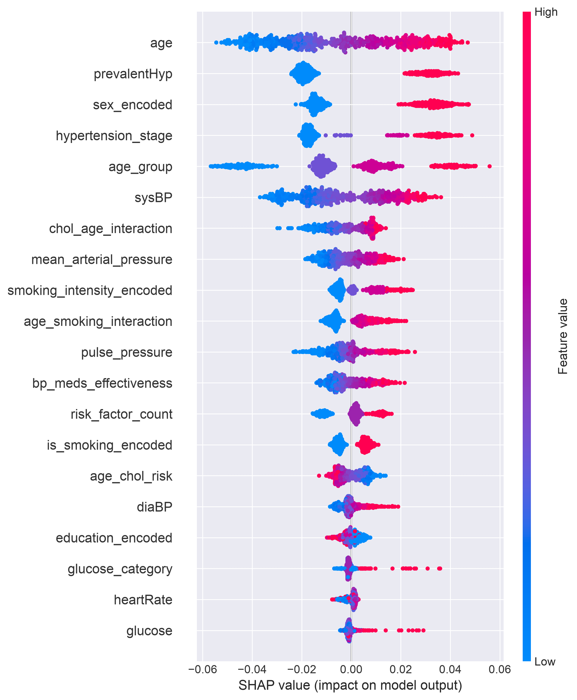
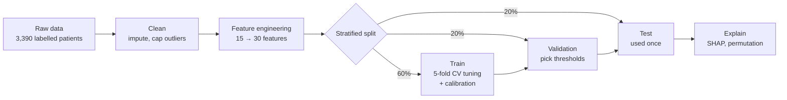

# Predicting 10-year heart disease risk with machine learning

This is my undergraduate dissertation project. I wanted to find out whether modern machine-learning models are actually better than plain logistic regression at predicting who will develop coronary heart disease (CHD) in the next ten years, or whether they just look more impressive.

I built an end-to-end pipeline in Python that cleans the Framingham Heart Study data, adds clinically motivated features, and tunes eight classifiers. It then evaluates them the way you'd want a clinical risk model evaluated: on held-out patients, with confidence intervals, calibration checks and decision curves. Finally it explains what the models rely on using SHAP.

It's built with pandas, scikit-learn, imbalanced-learn, XGBoost, LightGBM, CatBoost, InterpretML and SHAP, and it has a pytest suite that runs in a few seconds.

**The short answer is no.** On the held-out test set, logistic regression did as well as every tuned model, and all eight sit inside each other's confidence intervals. What made a real difference wasn't the algorithm but **calibration**: whether a predicted "20% risk" actually means a 20% risk.

<p align="center">
  
</p>

## Results

These numbers come from 678 patients the models never saw during training or tuning; 102 of them went on to develop CHD.

| Model | ROC-AUC (95% CI) | Avg. precision | Brier score | Sensitivity | Specificity |
|---|---|---|---|---|---|
| Logistic regression (baseline) | 0.710 (0.649–0.762) | 0.306 | 0.200 | 0.58 | 0.78 |
| SVM | 0.704 (0.644–0.760) | 0.304 | 0.118 | 0.45 | 0.82 |
| Explainable Boosting Machine | 0.695 (0.635–0.751) | 0.289 | 0.120 | 0.44 | 0.82 |
| Extra trees | 0.691 (0.628–0.747) | 0.279 | 0.121 | 0.49 | 0.75 |
| XGBoost | 0.687 (0.623–0.744) | 0.284 | 0.121 | 0.45 | 0.82 |
| CatBoost | 0.685 (0.620–0.736) | 0.273 | 0.121 | 0.38 | 0.83 |
| Random forest | 0.682 (0.617–0.736) | 0.272 | 0.121 | 0.44 | 0.82 |
| LightGBM | 0.675 (0.614–0.732) | 0.269 | 0.122 | 0.49 | 0.76 |

A quick guide to the columns:

- **ROC-AUC** measures how well a model ranks people who developed CHD above those who didn't (0.5 is a coin flip, 1.0 is perfect).
- **Average precision** focuses on the positive cases. Compare it with the 15% base rate, not with 1.0.
- **Brier score** is the squared error of the predicted probabilities. Lower is better, and it punishes risks that are systematically too high or too low.
- **Sensitivity and specificity** are measured at each model's decision threshold, which was picked on a separate validation set to maximise F1.
- Tuned models are shown after calibration. The uncalibrated versions are in `reports/tables/` after a run.

What I take from it:

1. **On this data, the choice of algorithm barely matters.** The whole spread of ROC-AUC (0.675 to 0.710) is smaller than the width of any single model's confidence interval. Pairwise DeLong tests agree: no difference survives a correction for the 28 comparisons. Fifteen routine measurements on 3,390 people don't leave much signal for a flexible model to find that a linear one misses.
2. **Calibration matters more than the model.** Only 15% of patients develop CHD, so the baseline was trained with class weights to stop it ignoring that group. That helps it rank patients, but it inflates the probabilities it outputs: its Brier score is 0.200, against about 0.12 for the calibrated models. The right-hand plot below shows the same effect for extra trees. Before calibration, a predicted 50% risk corresponded to an observed rate of about 20–25%.
3. **The model is useful in the range where prevention decisions get made.** Between risk thresholds of roughly 7% and 28%, acting on the calibrated SVM's predictions beats both "treat everyone" and "treat no one" (decision curve below). Above about 30% it adds essentially nothing. That range covers the 7.5–10% ten-year risk cut-offs US and UK guidelines use for statin discussions. Those guidelines score broader cardiovascular risk, not CHD alone, so treat this as a rough comparison.

<p align="center">
  
  
</p>

<p align="center">
  
</p>

### What drives the predictions

This is SHAP for the calibrated extra-trees model. I explain a tree model rather than the SVM on purpose: SHAP's TreeExplainer gives exact values for tree ensembles in seconds, while an SVM would need KernelExplainer, which is approximate and far slower.

<p align="center">
  
</p>

Age dominates, followed by existing hypertension, sex (`sex_encoded = 1` is male) and systolic blood pressure, all of which are established risk factors. The models agree on the big ones: age, blood pressure, and the interaction between cholesterol and age. Beyond those, their rankings diverge more than I expected: only 4 features appear in the top ten of extra trees, CatBoost *and* logistic regression. Several of my engineered features overlap (age, age group, cholesterol × age), and each model splits the credit between them differently. So I'd read any single feature ranking with some caution.

## How it works



`main.py` runs eight phases, and you can also run them one at a time:

| Phase | What happens |
|---|---|
| 1–2. Load and explore | Median and most-frequent imputation. Continuous features capped at the 1st/99th percentile. Statistical tests (Mann–Whitney, chi-square) and EDA plots. |
| 3. Feature engineering | Pulse pressure, mean arterial pressure, hypertension stage, WHO BMI bands, glucose bands, interaction terms, a risk-factor count. |
| 4. Class imbalance | Six resampling methods (SMOTE, Borderline-SMOTE, ADASYN, SMOTE-NC, SMOTE-Tomek, random undersampling) compared against plain class weights using 5-fold CV on the training split. Class weights won (CV ROC-AUC 0.710 vs 0.682–0.706), so the models use those. The one exception is the EBM, which doesn't support class weights and relies on its tuned decision threshold instead. |
| 5. Baseline | Standardised logistic regression with class weights. |
| 6. Tuning | SVM, random forest, extra trees, XGBoost, LightGBM, CatBoost and an Explainable Boosting Machine. Each gets a randomised search over up to 30 settings, scored by ROC-AUC with 5-fold stratified CV, plus a sigmoid-calibrated copy. |
| 7. Evaluation | Discrimination, calibration (Brier score, expected calibration error, calibration slope) and threshold metrics on the test set. 95% CIs from 500 stratified bootstrap resamples, DeLong tests between models, decision curves. |
| 8. Interpretation | SHAP (global, dependence and per-patient waterfall plots), permutation importance, how stable the SHAP rankings are under bootstrapping, error analysis by subgroup, cross-model comparison, and a model card. |

### Things I was careful about

- The test set is only used once. Hyperparameters come from cross-validation on the training split and decision thresholds from the validation split, so the final comparison happens on patients nothing was tuned against.
- Resampling, scaling and calibration all live inside scikit-learn / imbalanced-learn pipelines. They're fitted on training folds only, so the validation folds keep the real 15% prevalence.
- Each model corrects for the imbalance once: either resampling or class weights, never both. Doing both pushes the probabilities up twice.
- Every headline number comes with an interval. With roughly 100 positive cases in the test set, an AUC can swing by ±0.05 between bootstrap resamples, so a bare point estimate would overstate what we actually know.

### Bugs I found when I came back to it

Getting the project ready for GitHub meant re-reading code I hadn't looked at in months, and I found problems the original run had missed.

The worst was that outlier capping at the 5th/95th percentile was also applied to yes/no columns. Only 2.6% of patients are diabetic, so the 95th percentile of `diabetes` is 0, and capping quietly turned every diabetic into a non-diabetic. Blood-pressure medication went the same way. The models still scored around 0.70 AUC without that information, and that's the lesson I took from it: a reasonable-looking metric doesn't prove the pipeline is right.

The same limits were too tight for the continuous features as well. Every heart rate ended up between 60 and 98 bpm, so the bradycardia/tachycardia feature had one value for everyone. Capping is now at the 1st/99th percentile and skips binary columns.

A few smaller ones:

- A check meant to skip yes/no columns before a log transform was inverted. I removed the step rather than flip it, because the "fixed" version would have log-transformed blood pressure and glucose before feature engineering applies clinical thresholds in mmHg and mg/dL.
- Smoking intensity was encoded alphabetically, so heavy smokers got 0 and non-smokers got 3.
- The resampling "comparison" picked whichever method produced the most balanced classes, which every SMOTE variant does by design. It now compares methods by cross-validated ROC-AUC, and plain class weights won.

Each of these now has a regression test in [`tests/`](tests/).

### Limitations

- It's a small dataset: 3,390 labelled patients and 511 CHD cases, which leaves 102 positives in the test set. That's why the intervals are wide.
- It's one cohort, from a single town in Massachusetts and predominantly white. A model trained here would need recalibrating at the very least before it said anything about another population.
- Kaggle's `test.csv` has no outcome labels, so the held-out test set is carved out of the labelled file instead.
- Imputation medians and capping limits are computed on all 3,390 labelled rows before the split. Medians and 1st/99th percentiles barely move, but strictly they should be fitted on the training split only. Moving that preprocessing into the model pipelines is the proper fix.
- The baseline isn't calibrated, which flatters the tuned models on Brier score. Calibrating the logistic regression is the obvious next experiment.
- It's a student project, not a clinical tool.

## Running it

You need Python 3.12. On macOS, install the OpenMP runtime first (`brew install libomp`); XGBoost and LightGBM need it.

```bash
git clone https://github.com/Auslogger/heart-risk-ml-showdown.git
cd heart-risk-ml-showdown
python3.12 -m venv .venv && source .venv/bin/activate
pip install -r requirements.txt

pytest                                  # 80 tests, a few seconds
python main.py                          # whole pipeline, ~25 min on an M1 MacBook (mostly SVM + LightGBM tuning)
python main.py --phase 7                # or one phase at a time: 1-2, 3-4, 5, 6, 7, 8
python scripts/make_readme_figures.py   # rebuild the figures in docs/figures/
```

A full run writes about a hundred figures and tables, the trained models and a model card to `reports/` and `models/`. Both folders are git-ignored; the figures in this README are a curated copy in [`docs/figures/`](docs/figures/). When you run phases separately, later phases reload the engineered data from `data/processed/` and the trained models from `models/`.

## Project layout

```
├── main.py                      # runs the pipeline, phase by phase
├── src/
│   ├── config.py                # paths, seeds, split sizes, search spaces
│   ├── data_preprocessing.py    # loading, imputation, outlier capping, train/val/test split
│   ├── eda.py                   # exploratory plots and statistical tests
│   ├── feature_engineering.py   # clinical features and encodings
│   ├── class_imbalance.py       # resampling vs class weights comparison
│   ├── model_training.py        # baseline, tuning pipelines, calibration, thresholds
│   ├── evaluation.py            # test-set metrics, bootstrap CIs, DeLong, decision curves
│   ├── interpretation.py        # SHAP, permutation importance, model card
│   └── utils.py
├── tests/                       # pytest suite
├── scripts/make_readme_figures.py
├── docs/figures/                # figures used in this README
└── data/raw/                    # train.csv (labelled), test.csv (unlabelled)
```

## Data

I used the [Cardiovascular Study Dataset](https://www.kaggle.com/datasets/christofel04/cardiovascular-study-dataset-predict-heart-disea) that Christofel Ganteng published on Kaggle, which is based on the Framingham Heart Study. It covers 4,238 participants, split into `train.csv` (3,390 with outcomes) and `test.csv` (848 with outcomes withheld). Each row records:

- demographics: age, sex, education
- smoking: smoker or not, cigarettes per day
- medical history: blood-pressure medication, stroke, hypertension, diabetes
- exam measurements: cholesterol, blood pressure, BMI, heart rate, glucose

The target, `TenYearCHD`, is whether the person developed coronary heart disease within ten years.

Kaggle lists the dataset's licence as unknown. I've included the two CSVs (about 280 KB) so the project runs straight after cloning. If you're the owner and would rather they weren't here, open an issue and I'll take them down.

## Licence

The code is MIT-licensed (see [LICENSE](LICENSE)). The data isn't covered by that licence; see the section above.

---

Made by Gregory Korchagin ([github.com/Auslogger](https://github.com/Auslogger))
